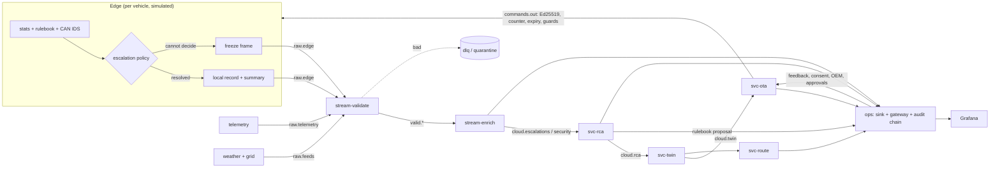

# Quantara: edge-first connected-vehicle protection (Configure 2026, Condense × Bosch MPS)

**Everything here is synthetic.** No real vehicle is ever read or controlled; the edge refuses any vehicle not flagged `sim:true` (`SANDBOX=1`).

The vehicle decides first. Cloud models are called only when the edge's explicit, unit-tested escalation policy says it cannot
decide (unattributed, low confidence, competing causes, unresolved too long, recurring, needs consent/software, fleet pattern,
security). Resolved issues leave the vehicle as a short summary, not raw data; counters report edge-resolved vs escalated and
bytes saved.

## Four repos (+ one small shared package)

| Repo | What | Condense apps |
|---|---|---|
| [`quantara-core`](https://github.com/abhinavships/quantara-core) (v0.3.0) | topic registry (data contract), bus, config, Ed25519 helpers | library |
| [`quantara-ingest`](https://github.com/abhinavships/quantara-ingest) | simulator + **edge agent** (rulebook, IDS, reduce-only actions, escalation policy, freeze frames, OTA client) | `quantara-ingest` (Input) |
| [`quantara-stream`](https://github.com/abhinavships/quantara-stream) | validate (DLQ, quarantine) → enrich (VSS, windows, context, routing) | `stream-validate`, `stream-enrich` (Transform) |
| [`quantara-services`](https://github.com/abhinavships/quantara-services) | RCA + fleet correlation + learning loop, digital twin, route optimiser, signed OTA with consent/rollouts | `svc-rca`, `svc-twin`, `svc-route`, `svc-ota` (Transform) |
| `quantara-ops` (this repo) | sink, gateway (JWT + HMAC + replay + rate limits + scoping + WebSocket), audit chain, UI, Grafana as code | `ops` (Output, HTTPS) |

Ten deployed apps at most (limit: 10): ingest, validate, enrich, rca, twin, route, ota, ops = **8**.



## Running it
Each repo has a Dockerfile (Python 3.12) and `requirements.txt`. On Condense: Build → Publish version → Deploy.
Shared env: `TOPIC_PREFIX` (`quantara_`), `KAFKA_BOOTSTRAP`, `KAFKA_SECURITY_PROTOCOL`, `KAFKA_SASL_MECHANISM`,
`KAFKA_SASL_USERNAME`, `KAFKA_SASL_PASSWORD`. Per app: `ROLE`; ingest: `FLEET_SIZE`, `SANDBOX`, `CLOUD_PUBKEY`;
ota: `SIGNING_KEY`; ops: `OPS_JWT_SECRET`, `OPS_USERS`, `DATABASE_URL`/`REDIS_URL` (optional), `PORT`, `SANDBOX`.
Credentials live only in Condense env or a gitignored `.env`. Generate a signing key pair with `quantara_core.crypto.gen_keypair()`;
the public half goes to ingest as `CLOUD_PUBKEY`, the private half to `svc-ota` as `SIGNING_KEY`.
Users: `python -c "from ops.auth import make_user; import json; print(json.dumps({'alice': make_user('<pw>', 'admin')}))"` → `OPS_USERS`.

## Reproduce the tests (real counts)
```
pip install -r requirements.txt pytest httpx
pytest        # per repo: core 6, ingest 46, stream 17, services 33, ops 25
```
## Data generator
`quantara-ingest/sim`: lumped thermal model (C dT/dt = k_gen·P² − (k_nat + k_flow·flow)(T − T_amb)), CAN bus, ~100 vehicles,
routes via OSRM (public demo server, with offline fallback), weather via Open-Meteo, simulated grid and stations.
Fault injection for the four events: breakdown, grid outage, performance degradation, cyber (CAN flood / fuzz / spoof / replay,
calibration tamper, telemetry-vs-physics mismatch). Inject from the UI (Actions → sandbox) or `control.inject`.

## What is simulated vs real
Simulated: vehicles, CAN, sensors, thermal physics, stations/grid state, owner and OEM approvals, route distances (straight line × 1.3).
Real: the Kafka pipeline on Condense, the rulebook/IDS/escalation logic, Ed25519 signatures and every guard, the gateway security
controls, the hash-chained audit log, the rollout state machine.
**Not verified live:** the Postgres code path and Grafana panels (tests use SQLite; SQL for Postgres written but unrun here); the
Redis cache is tested with a fake client only.

## Data-source licences
Open-Meteo weather: CC BY 4.0 (non-commercial API terms). OSRM public demo server / OpenStreetMap routing data: ODbL (© OpenStreetMap
contributors). No other external data. All telemetry is generated.

## AI-use disclosure
These four repositories were designed and written with Claude Code (Anthropic) inside the build window, driven by the team's brief and
architecture diagram; the team directed, reviewed and ran the Condense deployments. No code was copied from earlier repositories.
Tests were never weakened to pass; two assertions that were mis-specified (not the code) were corrected and are noted in decisions.md.

MIT licensed. See `SECURITY.md`, `decisions.md`, `docs/DEMO.md`.
